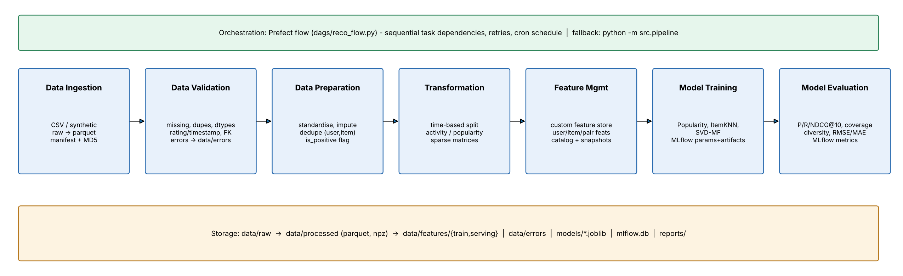

# Recommendation Data Pipeline

End-to-end, reproducible pipeline for a recommender system:

**Ingestion -> Validation -> Preparation -> Transformation -> Feature Management -> Training -> Evaluation -> Orchestration**



## Quick start

```bash
python -m venv .venv && source .venv/bin/activate      # Python 3.10+ (developed on 3.12)
pip install -r requirements.txt

python -m src.pipeline            # run all stages (plain Python)
python dags/reco_flow.py          # same stages as a Prefect flow
python -m src.reporting.build_artifacts   # diagram, run-summary image, PDF report
python -m pytest -q tests         # unit tests
mlflow ui --backend-store-uri sqlite:///mlflow.db        # browse runs at http://127.0.0.1:5000
```

Run from the repository root. A full run takes ~10 seconds. `python -m src.pipeline --from validation`
restarts from a later stage (earlier outputs on disk are reused).

### Prefect UI / screenshot of a successful run
```bash
prefect server start                                  # terminal 1 -> http://127.0.0.1:4200
export PREFECT_API_URL=http://127.0.0.1:4200/api      # terminal 2
python dags/reco_flow.py                              # open the UI and screenshot the flow run
python dags/reco_flow.py --serve                      # optional: daily 02:00 schedule
```
`reports/workflow_run.png` is generated from the recorded results of a real flow run, but it is **not** a
screenshot of the Prefect UI - take one with the commands above for the submission.

## Data
`configs/config.yaml -> data.source: synthetic` generates seeded synthetic data with *deliberately injected*
quality problems (see `src/ingestion/generate_synthetic.py`). To use a public dataset (e.g. MovieLens),
convert it to `data/raw/users.csv`, `items.csv`, `interactions.csv` with the schema below and set `data.source: csv`.

| File | Columns |
|---|---|
| users.csv | user_id, age, gender, country, signup_date |
| items.csv | item_id, title, category, release_year, price |
| interactions.csv | user_id, item_id, rating (1-5), timestamp |

## Stages
| Stage | Module | Output |
|---|---|---|
| Ingestion | `src/ingestion` | `data/processed/ingested_*.parquet`, manifest with MD5 |
| Validation | `src/validation` | `validated_*.parquet`, `data/errors/*_errors.csv`, `reports/data_validation_report.{md,json}` |
| Preparation | `src/preparation` | `clean_*.parquet` |
| Transformation | `src/transformation` | `train/test.parquet` (time split), user activity summary, item popularity, sparse matrices |
| Feature management | `src/features` | `data/features/{train,serving}/`, `reports/feature_catalog.{md,csv}` |
| Training | `src/training` | `models/*.joblib`, MLflow params + artifacts |
| Evaluation | `src/evaluation` | `reports/model_comparison.{csv,md,png}`, MLflow metrics |
| Orchestration | `dags/reco_flow.py`, `src/pipeline.py` | `reports/run_summary.json`, `reports/pipeline_run.log` |

## Models and metrics
Popularity baseline, item-KNN collaborative filtering, SVD matrix factorisation (also predicts ratings).
Metrics @K=10: Precision, Recall, NDCG, Coverage, Diversity (category-based intra-list), plus RMSE/MAE for rating predictors.
Relevant = test interactions with rating >= 4; recommendations exclude items seen in training.

## Reproducibility
Fixed `seed` and `reference_date` in config; all stage inputs/outputs are files; dependencies are pinned in `requirements.txt`.

## Project structure
```
configs/ dags/ data/{raw,processed,features,errors}/ models/ reports/ src/{ingestion,validation,preparation,
transformation,features,training,evaluation,reporting}/ tests/ requirements.txt README.md
```
